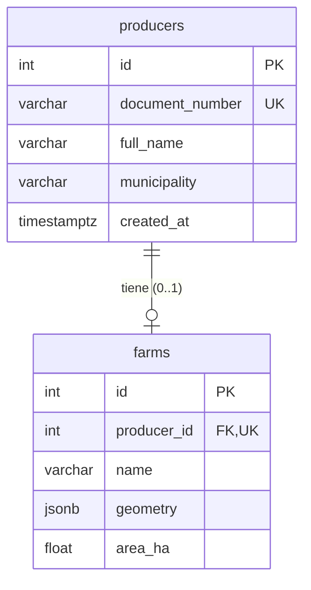

Raizul - Prueba Técnica
---
### Guia
Primero crear un archivo .env con las variables que muestra .env.example

Cualquier sistema operativo que cuente con docker puede ejecutar el siguiente comando e iniciar la aplicación (descargar docker si no cuentas con el):

```
docker compose up --build
```

Una vez iniciados los contenedores con Docker Compose, los servicios estarán disponibles desde el equipo local a través de las siguientes direcciones:

| Contenedor | Servicio | Dirección local |
|---|---|---|
| `db` | PostgreSQL 16 | `localhost:<puerto en el env>` |
| `api` | FastAPI | `http://localhost:8000` |
| `web` | React + Vite | `http://localhost:5173` |

**Nota:** La base de datos utiliza una conexión PostgreSQL, no una dirección HTTP. Los puertos indicados corresponden a los publicados por Docker Compose en el equipo local.

### Cómo correr las pruebas
El backend no se va a desplegar sin primero pasar todas las pruebas y mostrarlo en los losg, pero si se quieren comprobar manualmente, ejecutar el siguiente comando:
```
docker compose exec api pytest -v
```

### Stack tecnológico

| Componente | Tecnología | Uso |
|---|---|---|
| Backend | Python + FastAPI | Desarrollo de la API REST y gestión de la lógica de negocio. |
| Frontend | React + TypeScript + Vite | Construcción de la interfaz web y sus componentes. |
| Mapas | Leaflet + React-Leaflet | Visualización de las ubicaciones y delimitaciones geográficas de las fincas. |
| Base de datos | PostgreSQL 16 | Almacenamiento persistente de productores y fincas. |
| Contenedores | Docker + Docker Compose | Configuración y ejecución de los servicios en contenedores independientes.
---
### Base de datos

 
**`producers`**
 
| Columna | Tipo | Restricciones |
|---|---|---|
| `id` | integer | PK, identity |
| `document_number` | varchar(32) | NOT NULL, UNIQUE |
| `full_name` | varchar(200) | NOT NULL |
| `municipality` | varchar(100) | NOT NULL |
| `created_at` | timestamptz | NOT NULL, default `now()` |
 
**`farms`**
 
| Columna | Tipo | Restricciones |
|---|---|---|
| `id` | integer | PK, identity |
| `producer_id` | integer | NOT NULL, UNIQUE, FK → `producers.id` ON DELETE CASCADE |
| `name` | varchar(200) | NOT NULL |
| `geometry` | jsonb | NOT NULL, CHECK `geometry->>'type' = 'Polygon'` |
| `area_ha` | double precision | NOT NULL, CHECK `area_ha > 0` |
---
### Qué mejoraría con más tiempo

- **DevOps:** Incorporar flujos de CI/CD para automatizar las pruebas, validaciones y despliegues. Además, añadir herramientas de calidad de código: un *linter* para detectar errores y malas prácticas, un *type checker* para verificar la consistencia de los tipos, un *format checker* para mantener un formato de código uniforme y un *logger* para registrar eventos y errores que faciliten el diagnóstico de problemas.

- **Seguridad:** Implementar mecanismos de autenticación y autorización para controlar el acceso a los recursos, además de limitar las solicitudes a la API con un rate limiter para prevenir abusos y posibles ataques.

- **Microservicios:** Separar las funcionalidades del backend según sus responsabilidades y dominios de negocio, por ejemplo, un servicio para la gestión de productores y otro para la gestión de fincas y sus datos geográficos. Esto permitiría desarrollar, mantener y escalar cada servicio de manera independiente.

- **Diferentes ramas:** Incorporar una rama `develop` para integrar los cambios y ramas `feature/xxx` para desarrollar nuevas funcionalidades. Los cambios se integrarían mediante Pull Requests, permitiendo su revisión antes de incorporarlos a las ramas principales.

- **Mantenimiento:** Configurar ambientes independientes para desarrollo, pruebas y producción, cada uno con sus propias variables de entorno y configuraciones.

- **Documentación:** Ampliar la documentación del proyecto para explicar su arquitectura, estructura de carpetas, configuración y funcionamiento.

---
### Uso de IA

Se usó la IA para:

- Añadir comentarios basicos que explican que hacen los archivos del backend.
- Cración de los archivos de prueba en src/api/tests
- Creación de geojson de prueba en Ejemplos/
- Creacion de los archivos de la base de datos con el siguiente prompt:
```
CONTEXTO:
Se está creando una mini aplicación para registrar productores de cacao, subir el polígono de su finca en formato GeoJSON y verlo en un mapa.

MODELO DE DATOS:
- Productor (producers): id, document_number (único), full_name, municipality, created_at.
- Finca (farms): cada productor tiene una finca con name, la geometría en GeoJSON y area_ha calculada por el servidor.

REQUISITOS:
- Base de datos con PostgreSQL con SQLAlchemy 2.x. 
- Relación uno a uno entre productor y finca. 
- La geometría se guarda en una columna JSONB.
- Incluir la bd en un docker-compose para crear un contenedor con la bd.
```
- Creación del frontend con el siguiente prompt:
```
CONTEXTO:
Se está creando una mini aplicación para registrar productores de cacao, subir el polígono de su finca en formato GeoJSON y verlo en un mapa. El backend cuenta con los siguientes endpoints

- POST /producers: crea un productor. Responde 409 si el documento ya existe.
- GET /producers: lista los productores.
- POST /producers/{id}/farm: recibe un archivo .geojson y guarda la finca.
- GET /producers/{id}/farm: devuelve la finca como un Feature GeoJSON con name y area_ha en properties.

El backend está en un contenedor de Docker que se puede acceder en la siguiente dirección: http://localhost:8000

REQUISITOS:
- El front estará hecho con Vite - React y lenguaje TypeScript
- Para la graficación del mapa se usará la libreria MapLibre.
- Las vistas deben ser simples.
- Debe haber un header con dos pestañas, "Formularios" y "Mapa".
- En la pestaña de formularios estará un formulario para crear productor y otro para cargar del archivo y mapa con el polígono.
- Cada vez que se registre un formulario debe aparecer un mensaje de exito o error, y debe explicar la razón por la que ocurrió el error.
- En el mapa debe aparecer solo Colombia.
- Deben aparecer marcadores si el zoom está muy lejos que indiquen en donde están las fincas.
- Cuando se haga zoom en el mapa se deben mostrar las fincas graficadas, de color verde solido, y al momento de darles clic, debe aparecer un cuadro con el nombre del productor, la finca, el departamento y el area.
- Crear archivos Dockerfile y entrypoint.sh para asi tener el frontend en un contenedor de Docker

ESTRUCTURA:
├── src
│   ├── App.tsx
│   ├── main.tsx
│   ├── assets
│   │   └── 
│   ├── components
│   │   └── 
│   ├── pages
│   │   └── 
│   ├── services
│   │   └── 
│   └── styles
│       └── 
├── tsconfig.app.json
├── tsconfig.json
├── tsconfig.node.json
└── vite.config.ts
```

Cabe aclarar que se hizo `human in the loop` en cada resultado que entregó la IA, no se puede confiar ciegamente en lo que nos da y siempre hay que revisarlo primero.

---