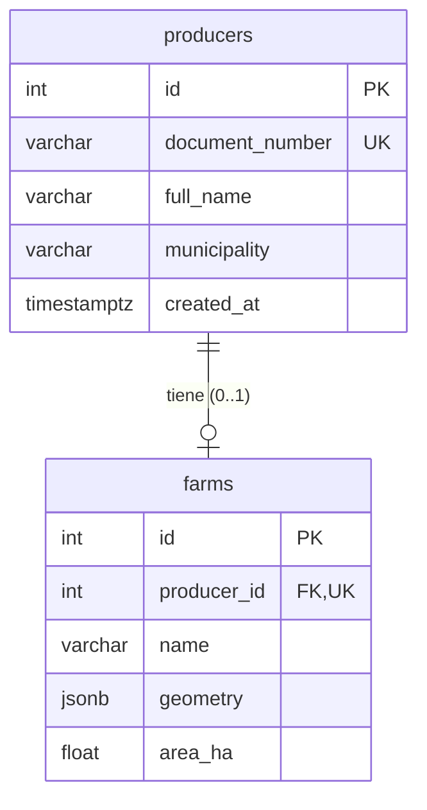

Raizul - Prueba Técnica
---
### Guia
Cualquier sistema operativo que cuente con docker puede ejecutar el siguiente comando e iniciar la aplicación:
```
docker compose up --build
```
---
### Stack tecnologico

- Backend: FastApi.
- Frontend: Vite con React.
- Base de datos: PostgreSQL 16 con SQLAlchemy 2.x.
---
### Base de datos

 
**`producers`**
 
| Columna | Tipo | Restricciones |
|---|---|---|
| `id` | integer | PK, identity |
| `document_number` | varchar(32) | NOT NULL, UNIQUE |
| `full_name` | varchar(200) | NOT NULL |
| `municipality` | varchar(100) | NOT NULL |
| `created_at` | timestamptz | NOT NULL, default `now()` |
 
**`farms`**
 
| Columna | Tipo | Restricciones |
|---|---|---|
| `id` | integer | PK, identity |
| `producer_id` | integer | NOT NULL, UNIQUE, FK → `producers.id` ON DELETE CASCADE |
| `name` | varchar(200) | NOT NULL |
| `geometry` | jsonb | NOT NULL, CHECK `geometry->>'type' = 'Polygon'` |
| `area_ha` | double precision | NOT NULL, CHECK `area_ha > 0` |
---
